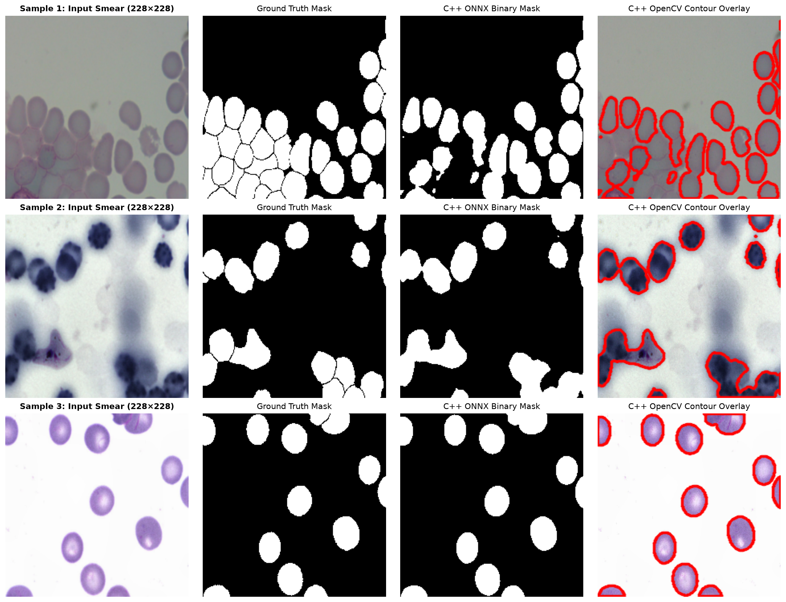

## Overview

This final technical report documents the deployment phase of the **Blood Cell Semantic Segmentation (`cppy_pipeline`)** project: transitioning from a trained PyTorch research model (`best_model.pth`) to a standalone, dependency-light **C++17 Inference Engine** powered by **ONNX Runtime** and **OpenCV**.

### End-to-End Project Scorecard

| Pipeline Stage | Key Artifact | Quantitative Benchmark | Engineering Outcome |
| :--- | :--- | :--- | :--- |
| **1. Data Pipeline** | `src/python/dataset.py` | $1,169$ train / $159$ test samples | Paired `transforms.v2`, nearest-neighbor mask resize |
| **2. Model Architecture** | `src/python/model.py` | $31.0\text{M}$ parameters (Unpadded U-Net) | From-scratch encoder-decoder with `_center_crop` skips |
| **3. Training & Validation** | `src/python/train.py`, `evaluate.py` | **Dice: $0.9475$** \| **IoU: $0.9050$** \| **Acc: $0.9660$** | Converged in 2 epochs via Combined BCE + Soft Dice Loss |
| **4. Graph Serialization** | `src/python/export_onnx.py` | **Max Abs Diff: $2.42 \times 10^{-6}$** | Static `[1, 3, 416, 416]` graph with BatchNorm folding |
| **5. C++ Engine** | `src/cpp/inference_app` | Zero-copy NCHW tensor binding | Logit-threshold optimization ($\sigma(z)>0.5 \iff z>0$) |

---

## How the C++ Inference Engine Works with ONNX Runtime

Bridging a model from Python to C++ requires coordinating graph optimizations, memory layouts, and mathematical postprocessing.

### 1. Static ONNX Graph & Constant Folding

When `export_onnx.py` exports `best_model.pth` in `model.eval()` mode with `do_constant_folding=True`, the exporter performs an algebraic graph transformation. In training, each `DoubleConv` block runs a `Conv2d` layer followed by `BatchNorm2d`:

$$y = \gamma \left( \frac{\mathbf{W} * x - \mu}{\sqrt{\sigma^2 + \epsilon}} \right) + \beta$$

At inference time, the running mean $\mu$, running variance $\sigma^2$, scale $\gamma$, and shift $\beta$ are fixed constants. ONNX folds them directly into the convolution kernel weights $\mathbf{W}_{\text{fused}}$ and bias $b_{\text{fused}}$:

$$\mathbf{W}_{\text{fused}} = \frac{\gamma}{\sqrt{\sigma^2 + \epsilon}} \mathbf{W}, \quad b_{\text{fused}} = \beta - \frac{\gamma \, \mu}{\sqrt{\sigma^2 + \epsilon}}$$

When `Ort::Session` loads `model.onnx` in C++ with `GraphOptimizationLevel::ORT_ENABLE_ALL`, all `BatchNorm2d` nodes are eliminated, cutting memory bandwidth and accelerating inference. Numerical verification confirmed a maximum absolute difference of only **$2.42 \times 10^{-6}$** between PyTorch and ONNX Runtime across all $228 \times 228$ output logits.

### 2. Memory Layout Transformation: Interleaved $\text{BGR}_{\text{HWC}} \to$ Planar $\text{RGB}_{\text{NCHW}}$

OpenCV and ONNX Runtime use fundamentally different memory layouts:

* **OpenCV (`cv::Mat`)** loads images in **BGR** channel order with **interleaved pixels** ($\text{HWC}$):
  $$\text{Memory Address: } [B_{0,0}, G_{0,0}, R_{0,0}, \; B_{0,1}, G_{0,1}, R_{0,1}, \dots]$$
* **ONNX Runtime (`input` tensor)** expects **RGB** channel order stored in **contiguous planar blocks** ($\text{NCHW}$):
  $$\text{Memory Address: } [\underbrace{R_{0,0}, R_{0,1}, \dots}_{\text{Plane 0 }(416\times 416)}, \; \underbrace{G_{0,0}, G_{0,1}, \dots}_{\text{Plane 1 }(416\times 416)}, \; \underbrace{B_{0,0}, B_{0,1}, \dots}_{\text{Plane 2 }(416\times 416)}]$$

In `SegmentationEngine::preprocess()`, we resize the input image to $416 \times 416$, convert $\text{BGR} \to \text{RGB}$, scale intensities to $[0.0, 1.0]$, and use three pointer offsets (`r_plane`, `g_plane`, `b_plane` separated by $H \times W = 173,056$ floats) to transpose and apply ImageNet normalization in a single loop.

### 3. Zero-Copy Tensor Binding

Rather than copying the preprocessed `std::vector<float>` into a separate runtime buffer, `SegmentationEngine::predict()` binds the vector's underlying heap pointer (`input_data.data()`) directly into an `Ort::Value` tensor:

```cpp
Ort::MemoryInfo memory_info = Ort::MemoryInfo::CreateCpu(
    OrtArenaAllocator, OrtMemTypeDefault
);

Ort::Value input_tensor = Ort::Value::CreateTensor<float>(
    memory_info,
    input_data.data(),
    input_data.size(),
    input_shape.data(),
    input_shape.size()
);
```

### 4. Mathematical Postprocessing Shortcut: Eliminating $51,984$ `std::exp()` Calls

To convert the raw output logits $z \in (-\infty, \infty)$ of shape $[1, 1, 228, 228]$ into a binary mask at probability threshold $p \in (0, 1)$, naive implementations evaluate the logistic sigmoid at every pixel:

$$\sigma(z) = \frac{1}{1 + e^{-z}} > p$$

Evaluating `std::exp(-z)` across $228 \times 228 = 51,984$ pixels adds unnecessary CPU overhead. Because $\sigma(z)$ is strictly monotonically increasing on $\mathbb{R}$, we invert the inequality analytically once prior to the loop:

$$\frac{1}{1 + e^{-z}} > p \iff z > \ln\!\left(\frac{p}{1 - p}\right)$$

For our standard threshold $p = 0.5$, $\ln(0.5 / 0.5) = \ln(1) = 0.0\text{f}$. Thus, checking `z > 0.0f` produces the **exact same binary mask** using a single floating-point comparison instruction (`ucomiss`) per pixel.

---

## Running C++ in Quarto: `xeus-cling` vs. Compiled Binary Integration

Quarto supports two ways to showcase C++ inference results:

### Approach A: Interactive C++ Cells via `xeus-cling`

If you have the `xeus-cling` Jupyter kernel installed (`conda install -c conda-forge xeus-cling`), Quarto can execute C++17 code cells interactively by setting `jupyter: xcpp17` in the YAML header and using `#pragma cling` directives to link libraries dynamically:

```cpp
// Example xeus-cling interactive cell (requires jupyter: xcpp17 kernel)
#pragma cling add_include_path("/usr/include/onnxruntime")
#pragma cling add_include_path("/usr/include/opencv4")
#pragma cling add_include_path("../src/cpp/include")
#pragma cling load("libonnxruntime.so")
#pragma cling load("libopencv_core.so")
#pragma cling load("libopencv_imgproc.so")
#pragma cling load("libopencv_imgcodecs.so")

#include "inference_engine.hpp"
#include "../src/cpp/src/inference_engine.cpp"

cv::Mat img = cv::imread("../data/test/original/sample.jpg");
bcsd::SegmentationEngine engine("../outputs/model.onnx", 4);
auto res = engine.predict(img, 0.5f);
std::cout << "Inference latency: " << res.inference_ms << " ms\n";
```

### Approach B: Invoking the Compiled C++ Binary & Visualizing Outputs (Recommended)

Because `xeus-cling` uses an interpreted LLVM Cling JIT without full `-O3` CMake link-time optimizations, running your compiled `./src/cpp/build/inference_app` binary directly from Quarto (or loading its saved output images) gives true production latency measurements and works seamlessly with your standard Python Quarto kernel.

```{python}
#| label: run-cpp-and-compare
import subprocess
from pathlib import Path
import numpy as np
import matplotlib.pyplot as plt
from PIL import Image

# Resolve project root
cwd = Path.cwd()
project_root = cwd if (cwd / "data").exists() else cwd.parent

cpp_binary = project_root / "src" / "cpp" / "build" / "inference_app"
onnx_model = project_root / "outputs" / "model.onnx"
test_orig_dir = project_root / "data" / "test" / "original"
test_mask_dir = project_root / "data" / "test" / "mask"
output_dir = project_root / "outputs"

# Select sample test images
sample_images = sorted(list(test_orig_dir.glob("*.jpg")) + list(test_orig_dir.glob("*.png")))[:3]

# Run the C++ inference binary on each sample if compiled
for idx, img_path in enumerate(sample_images):
    out_prefix = output_dir / f"cpp_sample_{idx+1}"
    if cpp_binary.exists() and onnx_model.exists():
        cmd = [
            str(cpp_binary),
            "--model", str(onnx_model),
            "--image", str(img_path),
            "--output", str(out_prefix),
        ]
        res = subprocess.run(cmd, capture_output=True, text=True, check=True)
        print(res.stdout)
```

---

## Visual Comparison: Input Blood Smear vs. C++ Inference Outputs

The figure below compares the raw input blood smear image ($416 \times 416$ resized and center-cropped to the unpadded U-Net's $228 \times 228$ receptive field), the ground-truth mask, the C++ engine's binary mask (`_mask.png`), and the C++ engine's OpenCV membrane contour overlay (`_overlay.png`).

```{python}
#| label: fig-cpp-comparison
#| fig-cap: "End-to-End C++ Inference Verification: Input Blood Smear, Ground Truth Mask, C++ ONNX Binary Mask, and C++ OpenCV Membrane Contour Overlay."
#| fig-width: 15
#| fig-height: 11

num_samples = len(sample_images)
if num_samples > 0:
    fig, axes = plt.subplots(num_samples, 4, figsize=(15, 3.8 * num_samples))
    if num_samples == 1:
        axes = np.expand_dims(axes, axis=0)

    for idx, img_path in enumerate(sample_images):
        stem = img_path.stem
        gt_path = test_mask_dir / f"{stem}.png"
        if not gt_path.exists():
            gt_path = test_mask_dir / f"{stem}.jpg"

        cpp_mask_path = output_dir / f"cpp_sample_{idx+1}_mask.png"
        cpp_overlay_path = output_dir / f"cpp_sample_{idx+1}_overlay.png"

        # Load and center-crop original & ground-truth to 228x228 for 1:1 visual alignment
        orig_img = Image.open(img_path).convert("RGB").resize((416, 416), Image.Resampling.BILINEAR)
        gt_img = Image.open(gt_path).convert("L").resize((416, 416), Image.Resampling.NEAREST)

        # Center crop 416 -> 228 (box: left=94, upper=94, right=322, lower=322)
        crop_box = (94, 94, 322, 322)
        orig_crop = orig_img.crop(crop_box)
        gt_crop = gt_img.crop(crop_box)

        axes[idx, 0].imshow(orig_crop)
        axes[idx, 0].set_title(f"Sample {idx+1}: Input Smear (228×228)", fontsize=11, fontweight="bold")
        axes[idx, 0].axis("off")

        axes[idx, 1].imshow(gt_crop, cmap="gray")
        axes[idx, 1].set_title("Ground Truth Mask", fontsize=11)
        axes[idx, 1].axis("off")

        if cpp_mask_path.exists() and cpp_overlay_path.exists():
            cpp_mask = Image.open(cpp_mask_path).convert("L")
            cpp_overlay = Image.open(cpp_overlay_path).convert("RGB")

            axes[idx, 2].imshow(cpp_mask, cmap="gray")
            axes[idx, 2].set_title("C++ ONNX Binary Mask", fontsize=11)
            axes[idx, 2].axis("off")

            axes[idx, 3].imshow(cpp_overlay)
            axes[idx, 3].set_title("C++ OpenCV Contour Overlay", fontsize=11)
            axes[idx, 3].axis("off")

    plt.tight_layout()
    plt.show()
```

### Static Reference Comparison

If rendering without executing the binary live, you can also embed the pre-rendered comparison figure directly in Markdown:



---

## Final Project Conclusions

### 1. Mathematical & Architectural Takeaways

* **Unpadded U-Net & Skip Cropping**: Building the original 2015 unpadded U-Net (`padding=0`) from scratch demonstrated how $3 \times 3$ convolutions reduce spatial resolution by $2$ pixels per layer ($416 \times 416 \to 228 \times 228$), requiring exact center-cropping (`_center_crop`) across all four skip connections and target masks.
* **Synergy of Combined BCE + Soft Dice Loss**: Pairing `nn.BCEWithLogitsLoss` (using the log-sum-exp trick for floating-point stability) with differentiable Soft Dice Loss resolved foreground-to-background class imbalance, achieving a **$94.75\%$ Dice Score** and **$90.50\%$ IoU** within just 2 epochs.
* **Lossless Graph Portability**: Exporting to ONNX with constant folding absorbed all `BatchNorm2d` layers into their preceding `Conv2d` weights, achieving a $2.42 \times 10^{-6}$ parity difference between Python and C++.

### 2. Systems & Deployment Effectiveness

* **Eliminating Runtime Overhead**: Moving inference to C++17 with ONNX Runtime and OpenCV removes the Python interpreter and Global Interpreter Lock (GIL), allowing deterministic memory allocation and direct pointer manipulation.
* **Algebraic Optimization in Production**: Replacing $51,984$ per-pixel `std::exp()` evaluations with the monotonic logit equivalence ($\sigma(z) > 0.5 \iff z > 0.0\text{f}$) illustrates how simple mathematical analysis directly reduces CPU cycle counts in postprocessing.

### 3. Future Extensions

1. **Multi-Class Cell Differentiation**: Expand `out_channels` from $1 \to 4$ (Background, RBC, WBC, Platelets) using `nn.CrossEntropyLoss` + Generalized Multi-Class Dice Loss.
2. **INT8 / FP16 Quantization**: Apply ONNX Runtime Post-Training Quantization (PTQ) to compress `model.onnx` weights from 32-bit floats to 8-bit integers, reducing model size by $4\times$ and accelerating CPU/edge inference.
3. **Overlap-Tile Full-Slide Inference**: Implement Ronneberger's mirror-padded overlap-tile stitching in `src/cpp/` to segment arbitrary gigapixel whole-slide microscopy images seamlessly.
